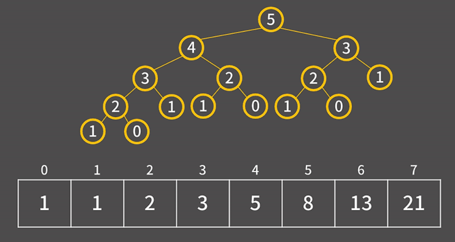
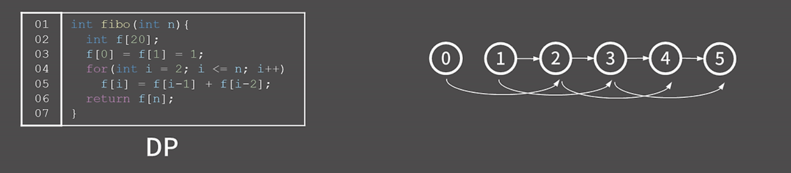
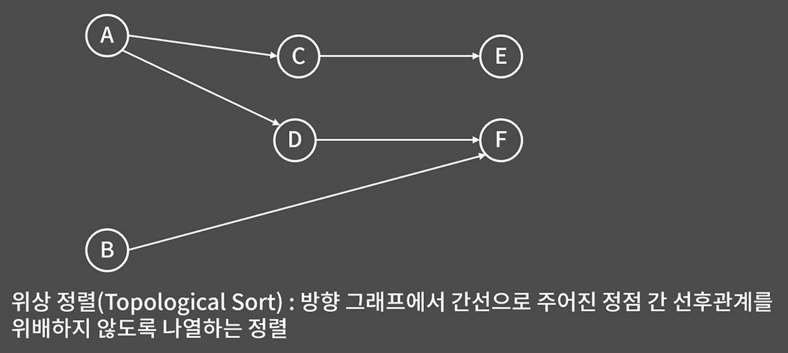
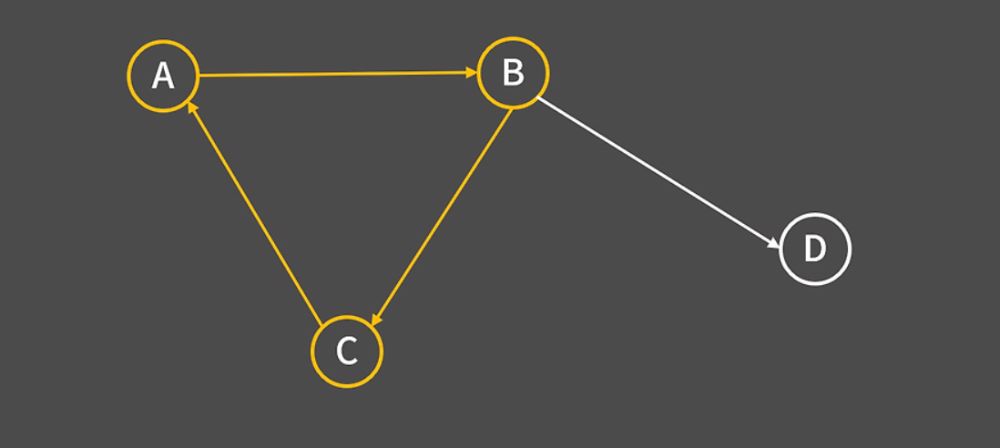
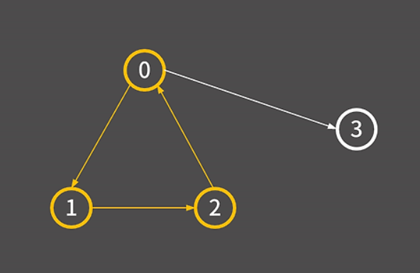

# 부록E - DP 심화

## DP 푸는 방식
여전히 DP를 푸는 방식에 대해서는 문제를 보고 
`테이블을 어떻게 잡을 것인가(dp[]이 배열을 뭐로 설정할지) 그리고 이 점화식을 어떻게 세울지`
스스로 알아내야 한다.
결론은 DP를 잘 풀기 위해서는 많은 DP문제를 접해야 한다는 것 그리고 그 감각을 익히는 것 밖에 없다.

0x10강이나 문제집의 문제들도 잘 풀고 많은 고민이 필요하다

### 여기서 할 것
자주 등장하는 DP 유형을 다시 한번 정리하고 좋은 문제를 추천한다

### 1.DP(다이나믹 프로그래밍) 이라는 것이 무엇인가?
여러개의 하위 문제로 먼저 푼 후 그 결과를 쌓아올려`(이전 하위문제의 계산 결과를 저장해 "중복계산" 을 피한다)` 문제를 해결한다

결국 이전의 계산 결과 위에 또 계산해서 계속 불려나가는 방식이라고 생각하면 된다.
그래서 이게 딱 점화식이라는 것이다.

일단 가장 대표적인 피보나치 수열을 생각해보자
```cpp
int fibo(int n){
    int f[20];
    f[0] = f[1] = 1;
    for(int i = 2; i <= n; i++){
        f[i] = f[i-1] + f[i-2];
    }
    return f[n];
}
```
가장 직관적으로 쉽게 알 수 있는 피보나치 수열로 보자면,
피보나치 수열에서 만약 중간값의 저장을 하지 않는다면 단순히 계속  재귀호출만을 계속 반복하면서 중복 계산이 계속 발생하게 되서,
시간 복잡도가 지수적으로 증가해버린다.


근데 DP를 이용해서 중간값을 저장한다면?

배열을 미리 선언하고 중간 결과를 저장하는 방식으로 DP를 적용하면, 의도한 대로 N번째 피보나치 수를 O(N) 시간에 계산할 수 있다.

바킹독
```
코딩 테스트 수준에서는 오히려 DP가 다른 알고리즘보다 유리할 수도 있다는 점입니다. 예를 들어 그리디나 구현 유형의 문제는 출제자의 의도나 문제 구성 방식에 따라 완전히 새로운 형태로 등장할 수 있기 때문에, 유사한 문제를 찾기가 어렵습니다. 반면 DP 문제는 출제자가 난이도를 비정상적으로 높이지 않는 한, 반드시 일정한 방식으로 테이블을 잡고 점화식을 세우는 패턴이 존재합니다. 그렇기 때문에 제가 계속 강조드리는 부분이기도 하지만, 좋은 문제들을 많이 풀어보면서 다양한 유형을 익히면 충분히 대비할 수 있습니다.
```
(DP가 오히려 푸는 방법이 테이블 세우고 점화식 찾는 방법으로 정형화되어 있어서 한번 공부만하면 여기서 크게 유형이 변화하지 않는다는 것)


그래프를 이용해서 설명해보면...<<방향그래프!!!>>

왼쪽에 있는 그래프 그림은 0과 1에서 화살표가 출발해서 2로 이어지고 있는데(즉, 2에 도달하고 있는 화살표가 총 2개인 상태이다),

이 화살표는 출발한 위치의 값이 먼저 계산되어야 도착한 위치의 값을 계산할 수 있다는 것이다.

(2개의 이전 state가 확정되야지 화살표를 받는 다음 state가 확정된다는 것)

이렇게 그래프를 구성하게 되면 자연스럽게 선후관계를 만족하는 순서로 배열이 채워지게 된다.

예를 들어서 f[0], f[1], f[2]를 순서대로 채운다면 f[2]를 채울때에는(f[i]) 이미 f[0], f[1](f[i-1], f[i-2])가 계산되어 있는 상태라 문제가 없게 됨.

하지만, 반대로 f[5], f[4], ..., f[0]의 순서로 채운다면? 
f[i] = f[i-1] + f[i-2] 이렇게 완성되야 하는데 f[5]의 경우 f[4]와 f[3]이 이미 완성되어 있어야 결정이 나는데 결정이 안나는 상태가 된다.

---

여기서 결국 DP가 방향그래프이고 선후관계가 있다는 말이라면 자연스럽게 말 할 수 있는 개념이 있다.
"위상 정렬"이라는 것으로 

결국 DP에서 테이블을 채운다는 것은 채워야 할 각 칸을 정점으로 보고 그 칸들 사이의 선후 관계를 그래프로 나타냈을 때 위상 정렬 순서에 따라 값을 채워야 한다는 뜻

쉬운 문제에서는 보통 0부터 차례로 채우는 방식처럼 이 흐름이 직관적으로 드러나기 때문이지만 어려운 문제는 0부터 채우는 것이 아니기 때문에 이런 개념이 나중에 이해를 도움.

---

위상정렬?

방향그래프에서 각 edge를 연결해서 vertex(정점)간 선후 관계가 일정하게 유지되도록 하는 것

위상 정렬의 특징은 그래프 내부에 절대로 cycle이 형성되면 안된다.


이 그림을 본다면 ABC 중에 그 어떤 것이 먼저 나오더라도 간선으로 주어진 정점 간 선후관계에 모순이 발생하기 때문

위상 정렬은 사이클이 존재하지 않는 방향 그래프에서만 잘 정의

사이클이 존재하지 않는 방향 그래프를 DAG(Directed Acyclic Graph)라고 줄여서 부른다

indegree를 이용해 1회 순회시 감소시키고 0이면 큐에 넣어 큐가 빌때가 재귀적 반복 <-- 보통 이 방식을 사용한다

자세한 것은 `위상정렬`페이지에서 설명한다(아직 미연결)

---

위의 위상정렬에 대해서 생각해볼때 DP 그래프에도 cycle이 생긴다면 어떻게 될까?



마찬가지로 DP 계산을 할 수 없게 된다. 계속 서로가 서로를 필요하게 되고 자신들끼리만 반복되니까 말이다.

예를 들어 f[0]을 채우기 위해 f[2]가 필요하고 f[2]를 채우기 위해 f[1]이 필요하며 f[1]을 채우기 위해 다시 f[0]이 필요하다면 서로 물고 물리게 되어 어떤 값도 먼저 계산할 수 없게 된다.
결국 셋 중 무엇도 먼저 구할 수 없는 상황이 되면 DP 풀이가 불가능해지는 것이다.

`(cycle이 존재해서는 안된다)`

결론: DP의 테이블을 정의하고 점화식을 세운 뒤 그 구조를 그래프로 표현한다고 했을 때에는 사이클이 존재하면 안 된다.

즉, DP는 방향그래프이면서 사이클이 없는 DAG, 즉 Directed Acyclic Graph여야 한다.

그리고 DP는 DAG 구조를 기반으로 위상 정렬 순서에 따라 테이블을 채워나가게 되는데 이때 진입 차수, 즉 indegree가 0인 정점들은 초기값이 된다.


여기에서 피보나치의 경우에는 본 피보나치 수열의 경우에서 f[0]과 f[1]이 초기값인 것이다

DP에 필요한 3가지
1. DP 배열은 어떤 값을 의미하는가?
2. 점화식(중간과정을 저장)
3. 초깃값


## BOJ 9251번: LCS
## Longest Common Subsequence, 최장 공통 부분 수열
이거 이도훈 알고리즘 시간에 배운 것이다.

2차원 DP의 대표적인 내용으로는 LCS가 있다.

항상 문제를 풀 때 테이블을 잘 정의하고 점화식을 잘 찾은 뒤 초기값을 설정하는 것을 중요시 여겨라.


